<h1 align="center">🌸 María Cisterna · Matrona</h1>

<p align="center">
  <a href="https://manecist.github.io/Matrona/">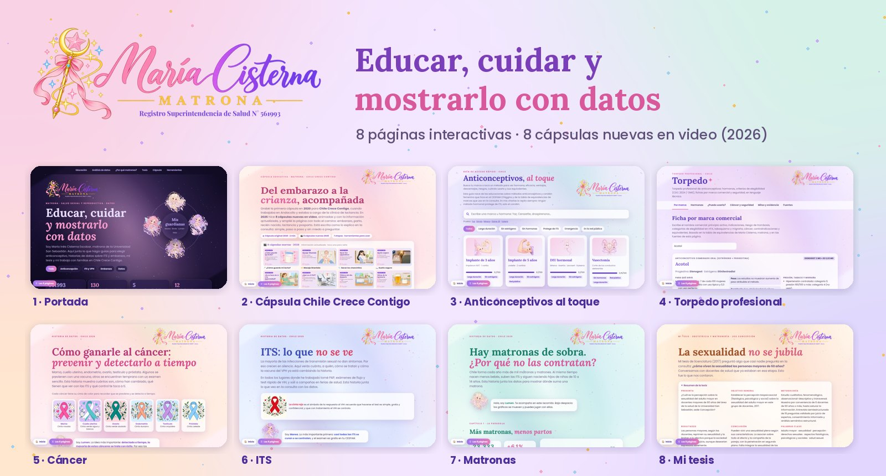</a>
</p>

<p align="center">
💜 Educar • Cuidar • Acompañar • Mostrarlo con datos 💜
</p>

<p align="center">
✨ <a href="https://manecist.github.io/Matrona/"><strong>Ver el portafolio en línea</strong></a> ✨<br>
<sub>Páginas educativas interactivas de salud sexual y reproductiva, hechas para Chile.</sub>
</p>

<p align="center">
  
  
  
  
  
</p>

> 📜 **Licencia:** © 2026 María Inés Cisterna Escobar, matrona. Todos los derechos reservados. Ver [LICENSE](LICENSE).

---

## 🧠 De qué se trata

Llevo a una página lo que explico en la consulta: **simple, paso a paso y con fuentes chilenas**.
Cada página sirve para la sala de espera, la casa o para compartir por WhatsApp.

🩺 Contenido clínico revisado por mí · 📊 Cifras de fuentes públicas · 🎨 Ilustraciones pensadas para cada tema

---

## 🗺️ Las páginas

| | Página | Para qué sirve |
|:-:|---|---|
| 🏠 | [**Portada**](https://manecist.github.io/Matrona/) | Entrada al portafolio, con filtros por tema |
| 🤰 | [**Cápsula Chile Crece Contigo**](https://manecist.github.io/Matrona/capsula.html) | Cápsula original de 2020, ampliada: embarazo, parto, recién nacido, lactancia y posparto en 7 etapas |
| 🎬 | [**8 cápsulas nuevas en video (2026)**](https://manecist.github.io/Matrona/capsula.html#misvideos) | Con información actualizada: leche materna, Shantala, chanchitos, sueño seguro, maternidad, PAP, píldora del día después y mitos de la lactancia |
| 📖 | [**Guías paso a paso + regalo**](https://manecist.github.io/Matrona/capsula.html#guias) | Shantala, guardar la leche, chanchitos, sueño seguro y cuidados del recién nacido, con imágenes; resumen y preguntas al final de cada cápsula; guía en PDF para descargar |
| 💊 | [**Anticonceptivos al toque**](https://manecist.github.io/Matrona/guia-anticonceptivos.html) | Busca tu marca y compara métodos |
| 📋 | [**Torpedo profesional**](https://manecist.github.io/Matrona/torpedo.html) | Ficha por marca, ¿puedo usarlo? (CDC/OMS), fecha probable de parto |
| 🎗️ | [**Cáncer**](https://manecist.github.io/Matrona/historia-cancer.html) | Prevenir y detectar a tiempo |
| 🔴 | [**ITS**](https://manecist.github.io/Matrona/historia-its.html) | Lo que no se ve: sífilis, VIH, VPH |
| 👩‍⚕️ | [**Matronas**](https://manecist.github.io/Matrona/historia-matronas.html) | Hay matronas de sobra, ¿por qué no las contratan? |
| 🎓 | [**Mi tesis**](https://manecist.github.io/Matrona/tesis.html) | «La sexualidad no se jubila» (USS, 2017) |

---

## 📷 Vista del proyecto

<p align="center">
<b>🏠 Portada</b><br>
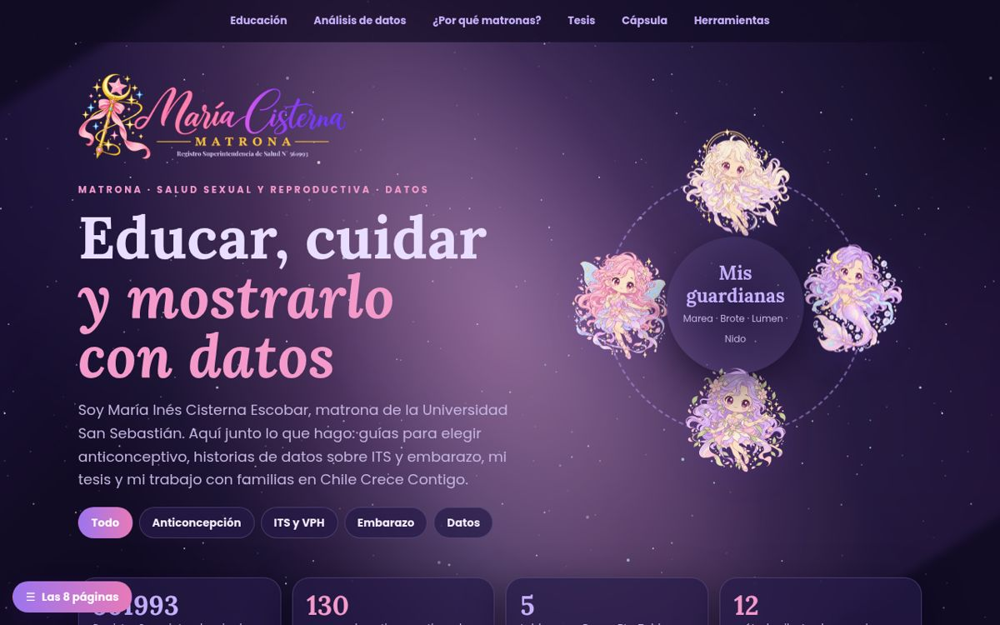
</p>

<p align="center">
<b>🤰 Cápsula Chile Crece Contigo</b><br>
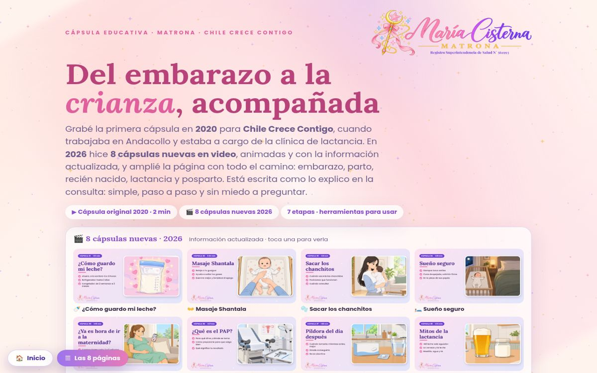
</p>

<p align="center">
<b>🎬 Mis 8 cápsulas nuevas en video (2026)</b><br>
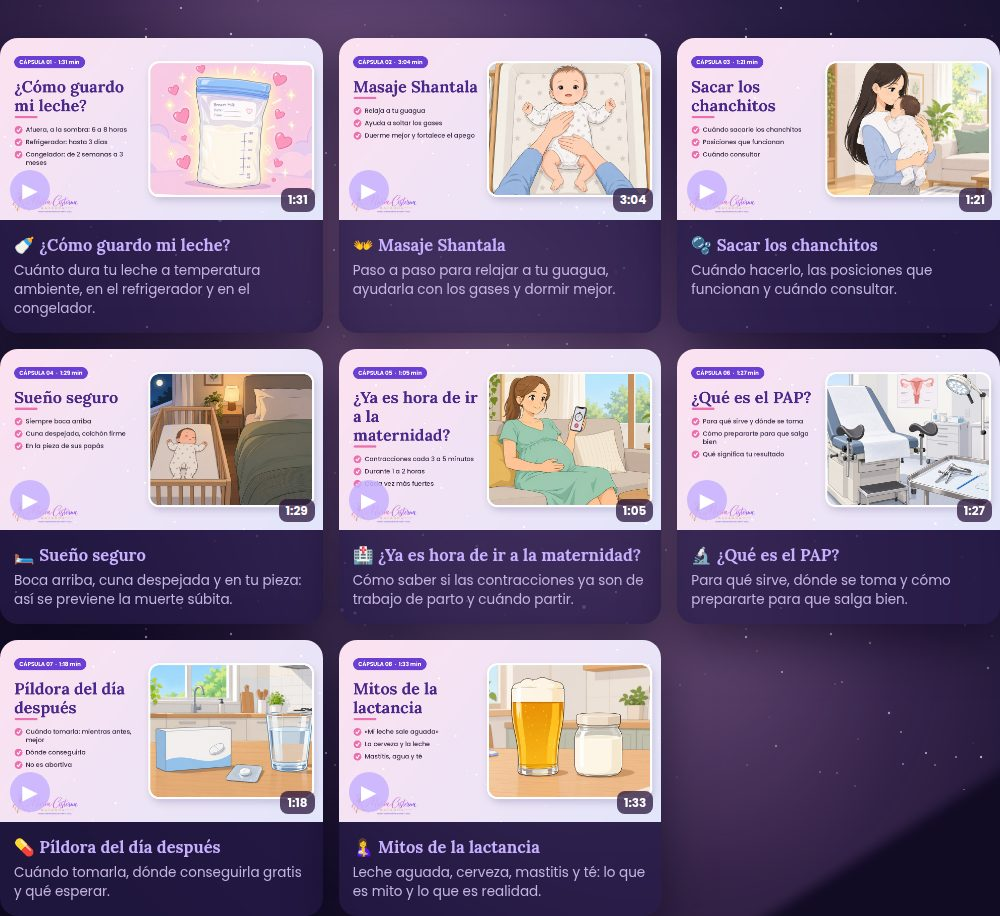
</p>

<table align="center">
<tr>
<td align="center"><b>💊 Anticonceptivos al toque</b><br>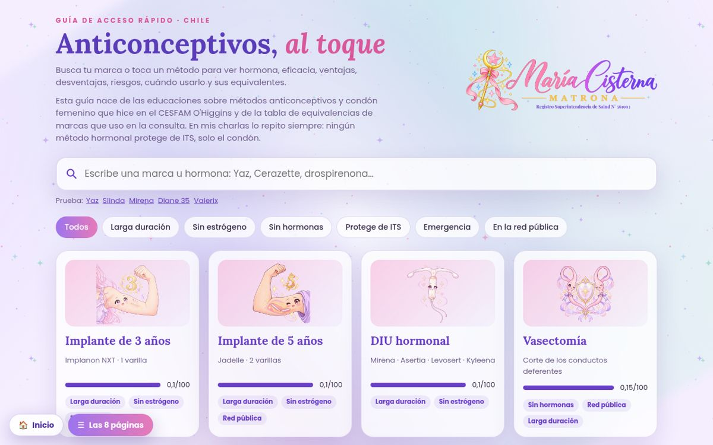</td>
<td align="center"><b>📋 Torpedo profesional</b><br>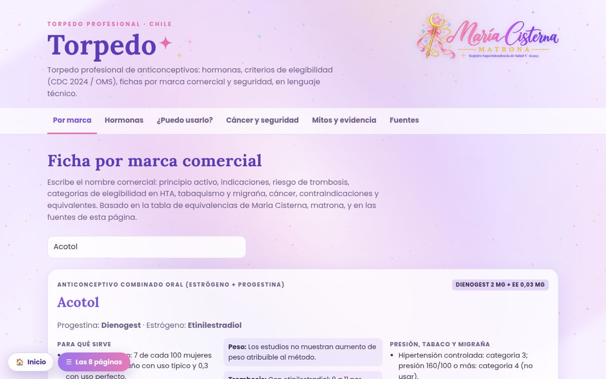</td>
</tr>
<tr>
<td align="center"><b>🎗️ Cáncer</b><br>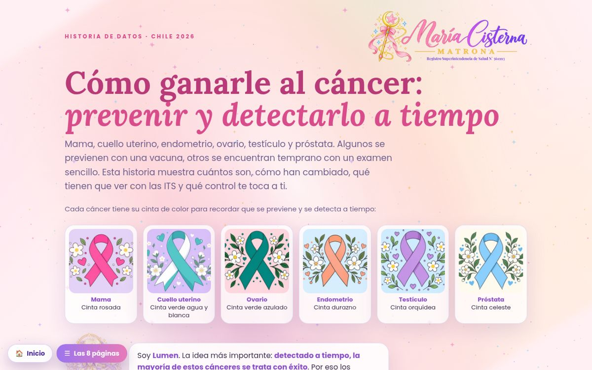</td>
<td align="center"><b>🔴 ITS</b><br>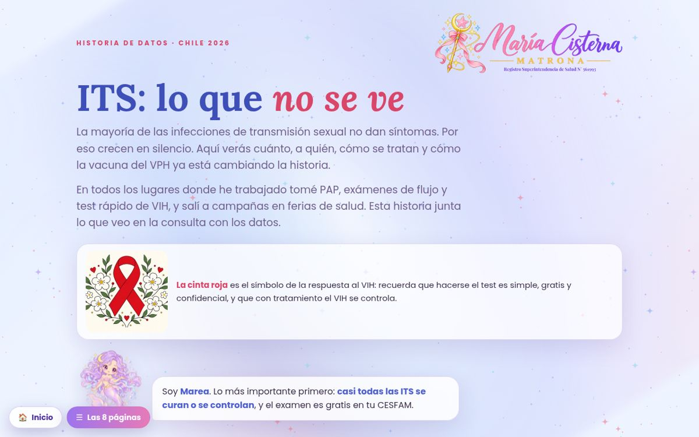</td>
</tr>
<tr>
<td align="center"><b>👩‍⚕️ Matronas</b><br>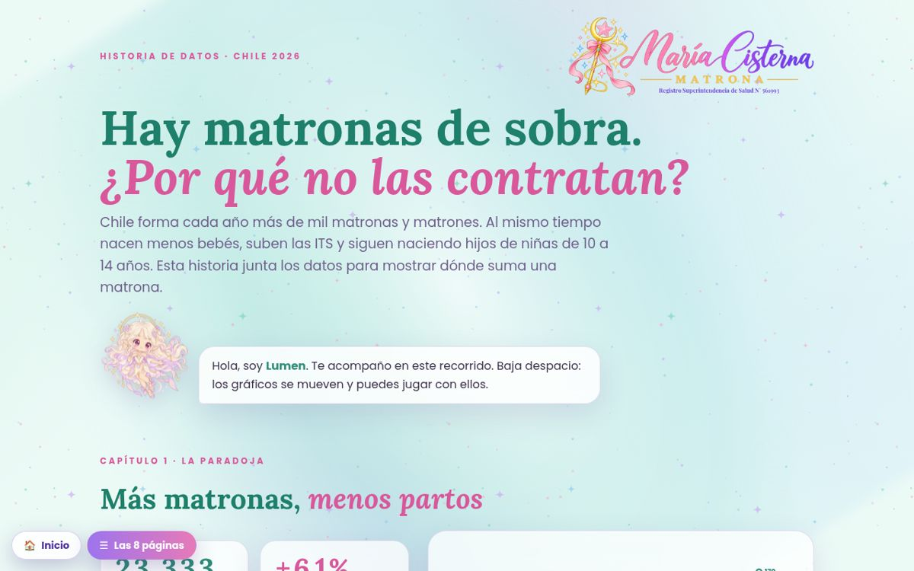</td>
<td align="center"><b>🎓 Mi tesis</b><br>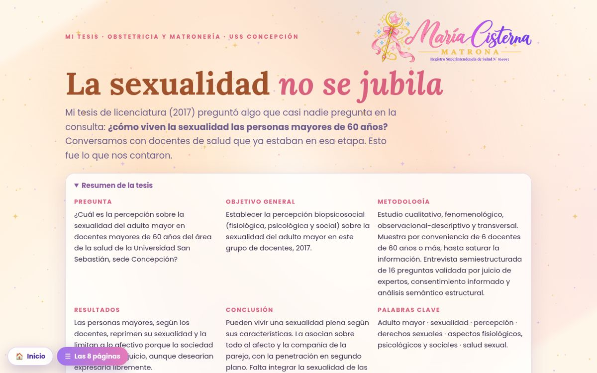</td>
</tr>
</table>

---

## ✨ Qué se puede hacer

🔎 Buscar un anticonceptivo por marca u hormona<br>
✅ Saber si puedo usar un método según mi salud (CDC 2024 / OMS)<br>
⏱️ Medir contracciones y ver la curva<br>
👶 Revisar los 17 reflejos del recién nacido, cada uno con su ilustración<br>
🟡 Ver la ictericia por zonas de Kramer<br>
🍼 Anotar mamadas y saber cuánto dura la leche guardada<br>
📅 Calcular edad gestacional y fecha probable de parto<br>
🧩 Responder quiz y mover los gráficos

---

## 🧾 Planilla de registro PAP

Planilla en Excel que armé para llevar el registro de PAP del CESFAM, sin perder a nadie de vista. 👉 [**Descargar**](planilla-pap/PAP_portafolio_MariaCisterna.xlsm)

📝 **Formulario para ingresar** a cada usuaria (botón INGRESAR, con macros)<br>
🧮 **Calcula sola** la edad, separa el resultado según la nomenclatura del informe y pone la fecha de **vigencia** del próximo PAP<br>
🚦 Marca el **estado** (al día o atrasado) y destaca en color los resultados para revisar<br>
📊 **Resumen anual**: PAP por mes y por año (2017 a 2023), derivaciones a UPC y VPH positivos, con gráficos

<table align="center">
<tr>
<td align="center"><b>Registro por año</b><br>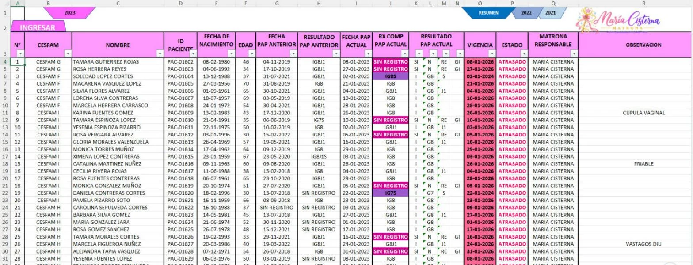</td>
<td align="center"><b>Resumen anual</b><br>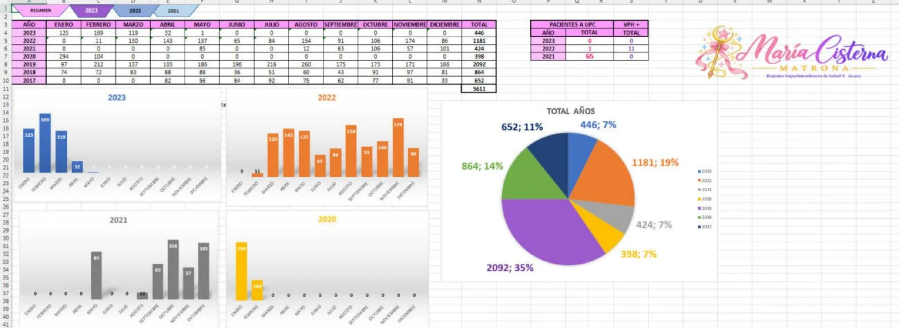</td>
</tr>
</table>

<sub>🔒 Todos los nombres y datos son 100 % ficticios. Al abrirla, Excel pide <i>habilitar contenido</i> para usar el formulario.</sub>

---

## 📊 Tableros

Los tableros de **Power BI y Tableau** están en su propio repositorio:
👉 [**Analisis-de-datos-dashboards**](https://github.com/manecist/Analisis-de-datos-dashboards)

---

## 📁 Organización

```text
Matrona/
├── index.html                 🏠 portada
├── capsula.html               🤰 cápsula Chile Crece Contigo
├── capsula/videos/            🎬 8 cápsulas + portadas
├── guia-anticonceptivos.html  💊 guía interactiva
├── guia-anticonceptivos/      🗂️ infografía y guía de 29 láminas
├── torpedo.html               📋 torpedo profesional
├── historia-*.html            📈 historias de datos (cáncer, ITS, matronas)
├── tesis.html                 🎓 mi tesis visual
├── planilla-pap/              🧾 planilla PAP con datos ficticios
├── datos/                     🐍 script de fichas por marca
└── assets/                    🎨 ilustraciones, logos y capturas
```

---

## 🔒 Privacidad · 🔎 Datos · ⚠️ Aviso

- 🔒 La **planilla PAP** usa datos **100 % ficticios**: no hay pacientes reales.
- 🔎 Las cifras vienen de **MINSAL, ISP, INE, OPS/OMS, GLOBOCAN y CDC**. Si un año no tiene dato público, no se inventó.
- ⚠️ Es **material educativo**: no reemplaza el control con tu matrona o médico.

---

<p align="center">
👩‍⚕️ <b>María Inés Cisterna Escobar</b> · Matrona · Universidad San Sebastián<br>
<sub>Registro Superintendencia de Salud N° 561993</sub>
</p>
